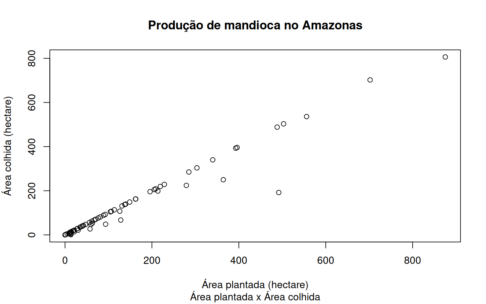

Importando o pacote


```r
library(amazonasdatahub)
```

## Gráfico de Dispersão entre Área plantada e Área colhida de produção de Mandioca

A base de dados `agriculture_amazonas` fornece dados de produção
agrícola do Amazonas. Podemos visualizar a dispersão da área plantada e
da área colhida de diferentes produções, mas para esse exemplo, usaremos
dados de produção de mandioca.

Para plotar um gráfico de dispersão simples no R, sem utilizar outros
pacotes, utilizaremos a função `plot`.


```r
# Filtrando dados
mandioca_prod <- agriculture_amazonas[agriculture_amazonas$cultivation == "Mandioca", ]

# Plotando o grafico
plot(
  mandioca_prod$planted,
  mandioca_prod$harvested,
  xlab = "Área plantada (hectare)",
  ylab = "Área colhida (hectare)",
  main = "Produção de mandioca no Amazonas",
  sub = "Área plantada x Área colhida"
)
```


