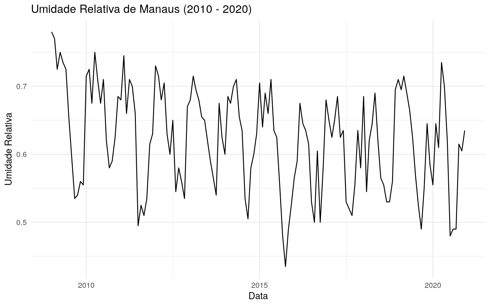

Importando o pacote


```r
library(amazonasdatahub)
```

## Série temporal da umidade relativa de Manaus (2010 - 2020)

Com o conjunto de dados `humidity_manaus`, que reune dados de umidade
relativa observados na cidade de Manaus de janeiro de 2009 a dezembro de
2020, podemos verificar séries temporais, e dentre elas, a da umidade
relativa durante esse intervalo de tempo.

Usando `dplyr`, podemos criar uma coluna de data, que será composta
pelos dados de mês e ano, e com o `ggplot2`, podemos criar o gráfico.


```r
# install.packages(c("dplyr", "ggplot2"))
require(dplyr)
require(ggplot2)

# Criando variavel de data unindo ano e mes, e em seguida,
# plotando o grafico
humidity_manaus %>%
  mutate(date = as.Date(paste0(year, "-", month, "-","01"))) %>%
  ggplot(aes(x = date, y = rh)) +
  geom_line() +
  theme_minimal() +
  labs(
    title = "Umidade Relativa de Manaus (2010 - 2020)",
    x = "Data",
    y = "Umidade Relativa"
  )
```


