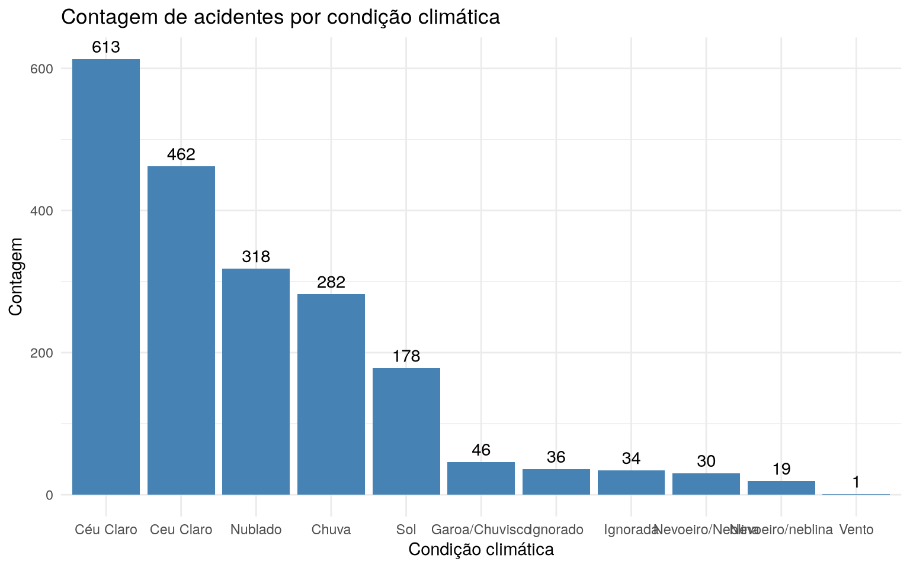

Importando o pacote


```r
library(amazonasdatahub)
```

## Boxplots do nível de água (em metros) do Rio Negro (Amazonas)

Com a base de dados `prf_amazonas`, podemos fazer análises de dados de
acidentes registrados pela Polícia Rodoviária Federal (PRF) no estado do
Amazonas no ano de 2025.

Podemos checar a frequência de acidentes por condição climática e
identificar qual dessas condições apresenta uma frequência maior de
acidentes.


```r
# Importanto pacotes para organizacao e visualizacao de dados
require(dplyr)
require(forcats)
require(ggplot2)

# Contando acidentes agrupados por condicao climatica e fazendo o grafico
prf_amazonas %>%
  count(weather) %>%
  mutate(
    weather = fct_reorder(weather, -n)
  ) %>%
  ggplot(aes(x = weather, y = n)) +
  geom_bar(stat = "identity", fill = "steelblue") +
  geom_text(aes(label = n), vjust = -0.5) +
  theme_minimal() +
  labs(
    title = "Contagem de acidentes por condição climática",
    x = "Condição climática",
    y = "Contagem"
  )
```


