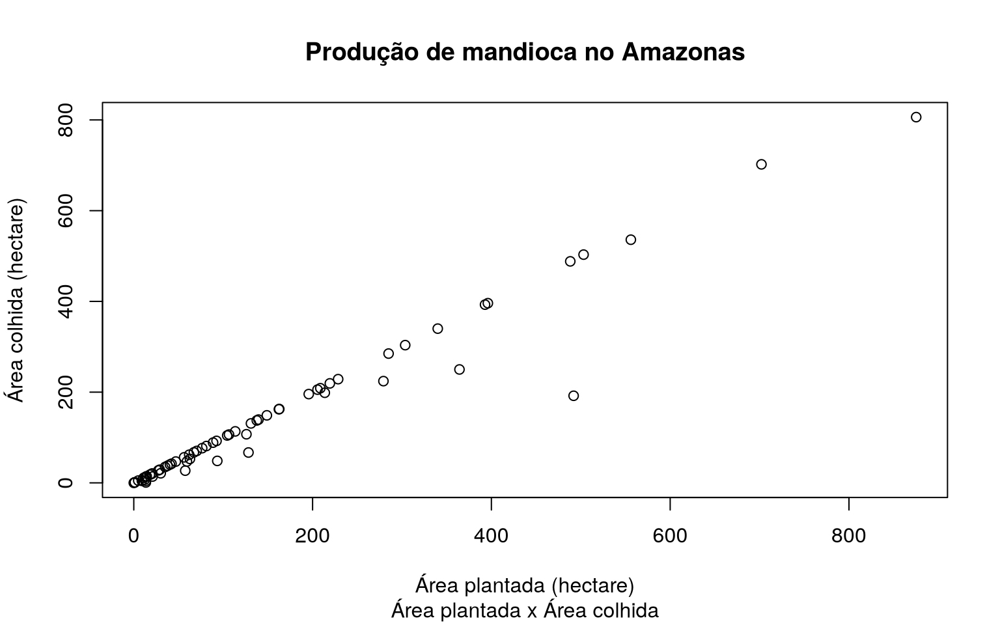

---

title: "Correlation analysis between planted area and harvested area of ​​vegetable production"
format: docusaurus-md

---


Importing the package


```r
library(amazonasdatahub)
```

## Scatterplot between planted area and harvested area of ​​cassava production

The `agriculture_amazonas` database provides production data
agriculture in Amazonas. We can visualize the dispersion of the planted area and
of the area harvested from different productions, but for this example, we will use
cassava production data.

To plot a simple scatterplot in R without using other
packages, we will use the `plot` function.


```r
# Filtrando dados
mandioca_prod <- agriculture_amazonas[agriculture_amazonas$cultivation == "Mandioca", ]

# Plotando o grafico
plot(
  mandioca_prod$planted,
  mandioca_prod$harvested,
  xlab = "Área plantada (hectare)",
  ylab = "Área colhida (hectare)",
  main = "Produção de mandioca no Amazonas",
  sub = "Área plantada x Área colhida"
)
```


