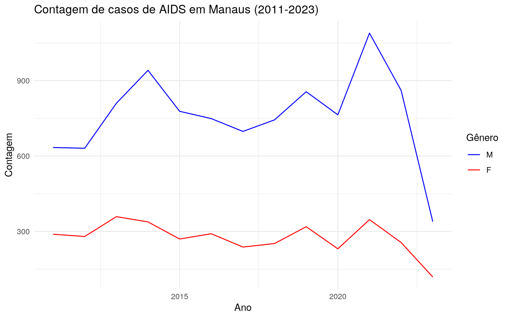

---

title: "Incidence of AIDS in Manaus"
format: docusaurus-md

---


Importing the package


```r
library(amazonasdatahub)
```

## Time series of AIDS case counts in Manaus

The `aids_amazonas` database provides data on AIDS occurrences
in the municipalities of Amazonas.

One of the analyzes that can be done is: checking the time series of the
case count filtered from a given municipality, where the cases are
grouped by the sex of the individual observed. To do this,
we will use the `dplyr` packages to structure the data, and `ggplot`
to make the chart and customize it.


```r
# install.packages(c("dplyr", "ggplot2", "lubridate"))
require(dplyr)
require(ggplot2)

# Filtrando dados, agrupando e plotando:
aids_amazonas %>%
  filter(name_muni == "Manaus") %>%
  group_by(gender) %>%
  ggplot(aes(x = year, y = cases, group = gender, color = gender)) +
  geom_line() +
  scale_color_manual(values = c("blue", "red")) +
  theme_minimal() +
  labs(
    title = "Contagem de casos de AIDS em Manaus (2011-2023)",
    x = "Ano",
    y = "Contagem",
    color = "Gênero"
  )
```


