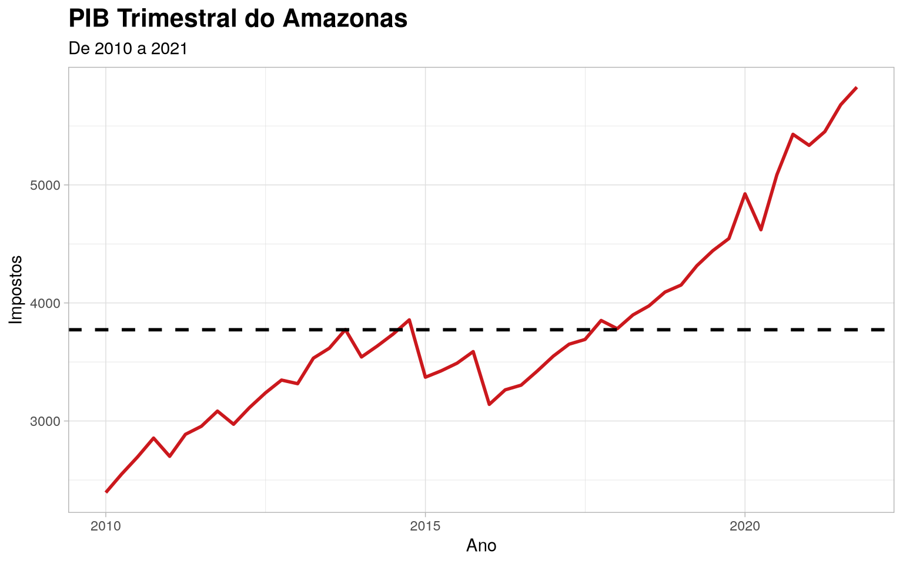

---

title: "Amazonas quarterly GDP time series"
format: docusaurus-md

---


Importing the package


```r
library(amazonasdatahub)
```

## Amazonas quarterly GDP time series

With the data from `gdp_amazonas`, we can perform analyzes regarding the
observed patterns in data distribution across the observed range
(2010 to 2021).

Using `dplyr`, we can select the variables of interest, and with
o `ggplot2`, we will create a line graph. This example will show this
application, as well as more advanced customizations, including colors,
title font formatting and line types.


```r
require(dplyr)
require(lubridate)
require(ggplot2)

gdp_amazonas %>%
  mutate(date = make_date(year, (as.numeric(as.character(quarter)) - 1)*3 + 1, 1)) %>%
  select(date, taxes) %>%
  ggplot(aes(x = date, y = taxes)) +
  geom_line(linewidth = 1L, colour = "#cb181d") +
  geom_hline(
        yintercept = mean(gdp_amazonas$taxes),
        linetype = "dashed",
        size = 1
  ) +
  theme_light() +
  theme(
        plot.title = element_text(face = "bold", size = 16)
  ) +
  labs(
       x = "Ano",
       y = "Impostos",
       title = "PIB Trimestral do Amazonas",
       subtitle = "De 2010 a 2021"
  )
```


