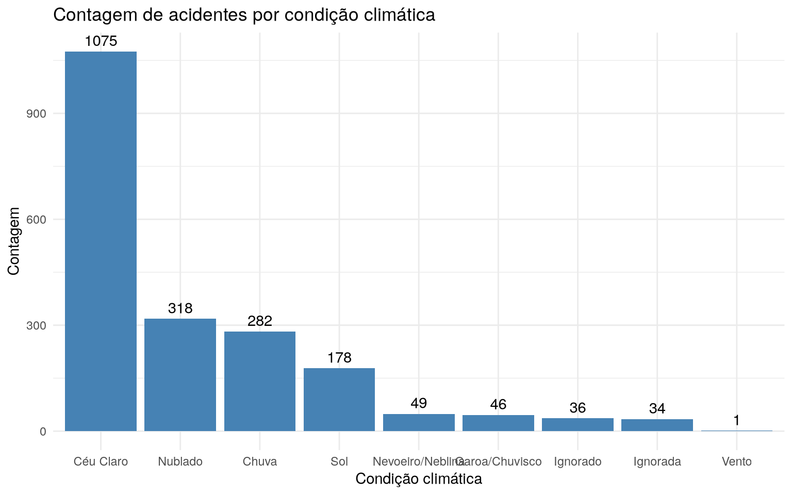

---

title: "Accident count by weather condition"
format: docusaurus-md

---


Importing the package


```r
library(amazonasdatahub)
```

## Accident count by weather condition

With the `prf_amazonas` database, we can perform data analysis of
accidents registered by the Federal Highway Police (PRF) in the state of
Amazonas in the year 2025.

We can check the frequency of accidents by weather condition and
identify which of these conditions presents a higher frequency of
accidents.


```r
# Importanto pacotes para organizacao e visualizacao de dados
require(dplyr)
require(forcats)
require(ggplot2)

# Contando acidentes agrupados por condicao climatica e fazendo o grafico
prf_amazonas %>%
  count(weather) %>%
  mutate(
    weather = fct_reorder(weather, -n)
  ) %>%
  ggplot(aes(x = weather, y = n)) +
  geom_bar(stat = "identity", fill = "steelblue") +
  geom_text(aes(label = n), vjust = -0.5) +
  theme_minimal() +
  labs(
    title = "Contagem de acidentes por condição climática",
    x = "Condição climática",
    y = "Contagem"
  )
```


See that the `Céu claro` condition is divided, since one has
written with an acute accent `Céu claro` and another is without an acute accent,
`Ceu claro`. We can individually assess weather conditions
available to check if it makes sense.


```r
unique(prf_amazonas$weather)
```

``` text
 [1] "Ceu Claro"        "Nublado"          "Ignorada"         "Chuva"           
 [5] "Nevoeiro/neblina" "Sol"              "Vento"            "Céu Claro"       
 [9] "Ignorado"         "Nevoeiro/Neblina" "Garoa/Chuvisco"  
```

Note that in addition to `Céu claro`, we have `Nevoeiro/Neblina` and
`Nevoeiro/neblina`. This small change of capital letters already
interferes with data reading. So let's standardize


```r
prf_amazonas_clean <- prf_amazonas %>%
  mutate(
    weather = case_when(
      weather == 'Ceu Claro' ~ 'Céu Claro',
      weather == 'Nevoeiro/neblina' ~ 'Nevoeiro/Neblina',
      TRUE~weather
    )
  )
```

It is now possible to view the bar graph of the corrected data.


```r
prf_amazonas_clean %>%
  count(weather) %>%
  mutate(
    weather = fct_reorder(weather, -n)
  ) %>%
  ggplot(aes(x = weather, y = n)) +
  geom_bar(stat = "identity", fill = "steelblue") +
  geom_text(aes(label = n), vjust = -0.5) +
  theme_minimal() +
  labs(
    title = "Contagem de acidentes por condição climática",
    x = "Condição climática",
    y = "Contagem"
  )
```


