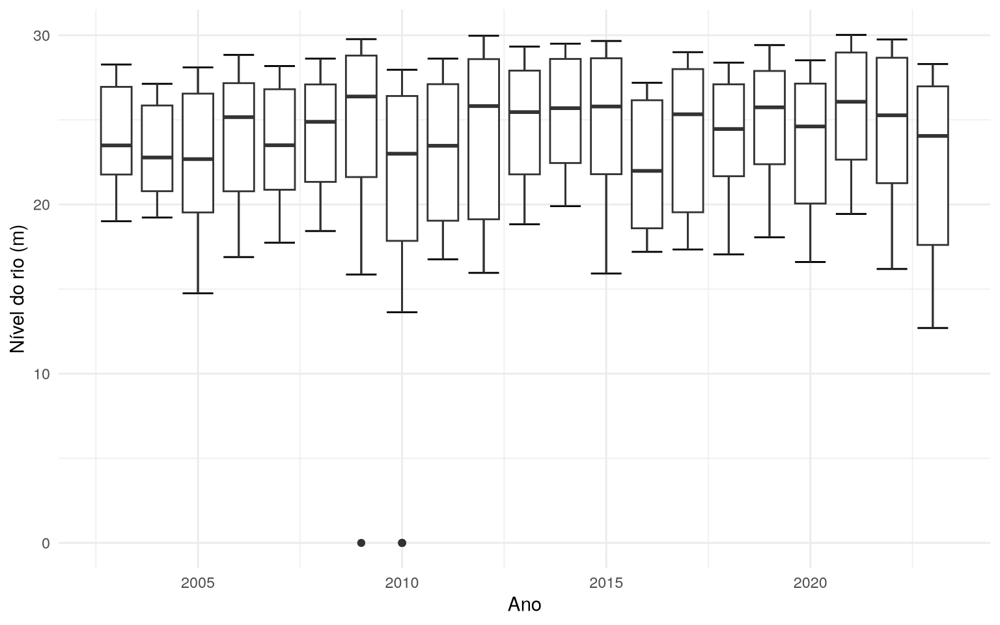
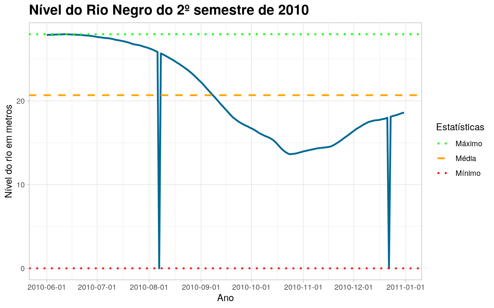
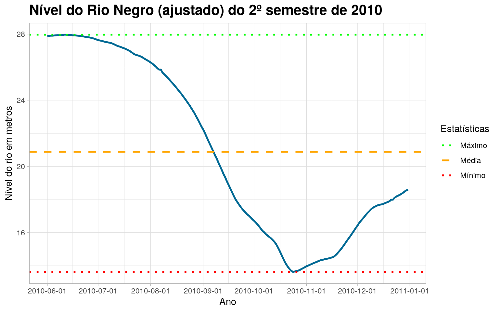

---

title: "Boxplots of the water level (in meters) of the Rio Negro (Amazonas)"
format: docusaurus-md

---


Importing the package


```r
library(amazonasdatahub)
```

## Boxplots of the water level (in meters) of the Rio Negro (Amazonas)

With the water level and year data from `rionegro_amazonas`, one of the
analysis that can be done is that of boxplots over the years.

We will use `ggplot2` to make this graph.


```r
require(ggplot2)
require(dplyr)

rionegro_amazonas %>%
  ggplot(aes(x = year, y = level_m, group = year)) +
  stat_boxplot(geom = "errorbar") +
  geom_boxplot() +
  theme_minimal() +
  labs(
    x = "Ano",
    y = "Nível do rio (m)"
  )
```



<details class="code-fold">
<summary>Code</summary>

```r
require(dplyr)
require(ggplot2)

# Filtrando datas para o segundo semestre de 2010
rionegro_amazonas_2010_02 <- rionegro_amazonas %>%
  filter(date >= "2010-06-01" & date <= "2010-12-31")

# Visualização Gráfica
rionegro_amazonas_2010_02 %>%
  ggplot(., aes(x = date, y = level_m)) +
  geom_line(size = 1L, colour = "#006994") +
  geom_hline(
        aes(
            yintercept = mean(rionegro_amazonas_2010_02$level_m),
            color = "Média"
        ),
        linetype = "dashed",
        size = 1
  ) +
  geom_hline(
        aes(
            yintercept = min(rionegro_amazonas_2010_02$level_m),
            color = "Mínimo"
        ),
        linetype = "dotted",
        size = 1
  ) +
  geom_hline(
        aes(
            yintercept = max(rionegro_amazonas_2010_02$level_m),
            color = "Máximo"
        ),
        linetype = "dotted",
        size = 1
  ) +
  scale_color_manual(
        name = "Estatísticas",
        values = c(
                   "Média" = "orange",
                   "Mínimo" = "red",
                   "Máximo" = "green"
                  )) +
  scale_x_date(
        date_breaks = "1 month"
  ) +
  theme_light() +
  theme(
        plot.title = element_text(face = "bold", size = 16)
  ) +
  labs(
       x = "Ano",
       y = "Nível do rio em metros",
       title = "Nível do Rio Negro do 2º semestre de 2010"
  )
```

</details>



### Missing data and outliers

Part of the Statistician's job is to identify and find certain errors
and inconsistencies in the data. Let's see that the graph above shows that the level
of Rio Negro in meters was 0. This is strange and unusual, as
would indicate that the river has completely dried up.

We can conclude that these “0” values, seen in the Boxplots graph,
correspond to missing data (NA), which were filled in with the
zero value. We will replace these zero values ​​with NAs.


```r
require(tidyr)
rionegro_amazonas_2010_02 <- rionegro_amazonas_2010_02 %>%
  mutate(
    level_m = case_when(
      date == "2010-08-07" ~ NA_real_,
      date == "2010-12-22" ~ NA_real_,
      TRUE ~ as.numeric(level_m)
    ),
    increase_decrease_cm = case_when(
      date == "2010-08-07" ~ NA_real_,
      date == "2010-12-22" ~ NA_real_,
      TRUE ~ as.numeric(increase_decrease_cm)
    )
  )
```

### Treatment of Missing Values ​​(NA)

Now that we have defined the missing values, we can choose a method
to treat them. In this example, we will use Forward-Fill, but we encourage
you to research and try to use other methods to learn
different ways of treating missing values.


```r
require(tidyr)

rionegro_amazonas_2010_02 <- rionegro_amazonas_2010_02 %>%
  fill(level_m, increase_decrease_cm)
```

With the processed data, we can recreate the graph and visualize the level of
Rio Negro.

### Graphic visualization of the Rio Negro level (2010/2)

<details class="code-fold">
<summary>Code</summary>

```r
require(dplyr)
require(ggplot2)

# Visualização Gráfica
rionegro_amazonas_2010_02 %>%
  ggplot(., aes(x = date, y = level_m)) +
  geom_line(size = 1L, colour = "#006994") +
  geom_hline(
        aes(
            yintercept = mean(rionegro_amazonas_2010_02$level_m),
            color = "Média"
        ),
        linetype = "dashed",
        size = 1
  ) +
  geom_hline(
        aes(
            yintercept = min(rionegro_amazonas_2010_02$level_m),
            color = "Mínimo"
        ),
        linetype = "dotted",
        size = 1
  ) +
  geom_hline(
        aes(
            yintercept = max(rionegro_amazonas_2010_02$level_m),
            color = "Máximo"
        ),
        linetype = "dotted",
        size = 1
  ) +
  scale_color_manual(
        name = "Estatísticas",
        values = c(
                   "Média" = "orange",
                   "Mínimo" = "red",
                   "Máximo" = "green"
                  )) +
  scale_x_date(
        date_breaks = "1 month"
  ) +
  theme_light() +
  theme(
        plot.title = element_text(face = "bold", size = 16)
  ) +
  labs(
       x = "Ano",
       y = "Nível do rio em metros",
       title = "Nível do Rio Negro (ajustado) do 2º semestre de 2010"
  )
```

</details>



Therefore, it is notable that the treatment of these outlier values, which were
considered missing made all the difference in the conclusion about the data from the
level of the Rio Negro.
