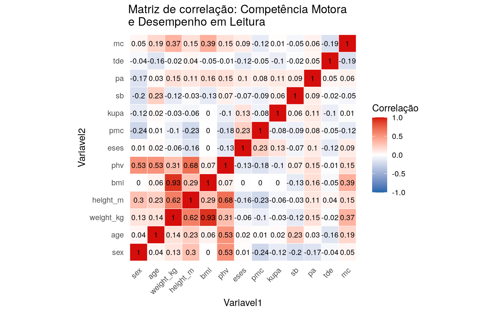

---

title: "Relationship between Physical Literacy and Reading Performance"
format: docusaurus-md

---


Importing the package


```r
library(amazonasdatahub)
```

## Relationship between Physical Literacy and Reading Performance

With the `srl_muni` database, we can reproduce the results
scholars from its source. When analyzing the correlation between the variables,
we can note that physical literacy and motor competence `mc` have
significant correlation with reading performance \``tde`.


```r
# Importanto pacotes para organizacao e visualizacao de dados
require(ggplot2)
require(dplyr)

# Selecionando as variáveis numéricas e determinando a matriz de correlação
corr <- srl_muni %>%
    select(where(is.numeric)) %>%
    cor()


# Convertendo a matriz para dataframe
corr_df <- as.data.frame(as.table(corr))
names(corr_df) <- c("Variavel1", "Variavel2", "Correlacao")


# Plotando a matriz de correlação
ggplot(corr_df,
    aes(x = Variavel1, y = Variavel2, fill = Correlacao)
  ) +
  geom_tile(color = "white") +
  geom_text(
    aes(label = round(Correlacao, 2)), size = 3) +
  scale_fill_gradient2(
    low = "#2166AC",
    mid = "white",
    high = "#d50e0b",
    midpoint = 0,
    limits = c(-1, 1),
    name = "Correlação"
  ) +
  coord_fixed() +
  labs(
    title = "Matriz de correlação: Competência Motora \ne Desempenho em Leitura", 
  ) +
  theme_minimal() +
  theme(
    axis.text.x = element_text(
      angle = 45,
      hjust = 1
    ),
    panel.grid = element_blank()
  )
```



We can notice that the results are similar to the results of the article
original.
